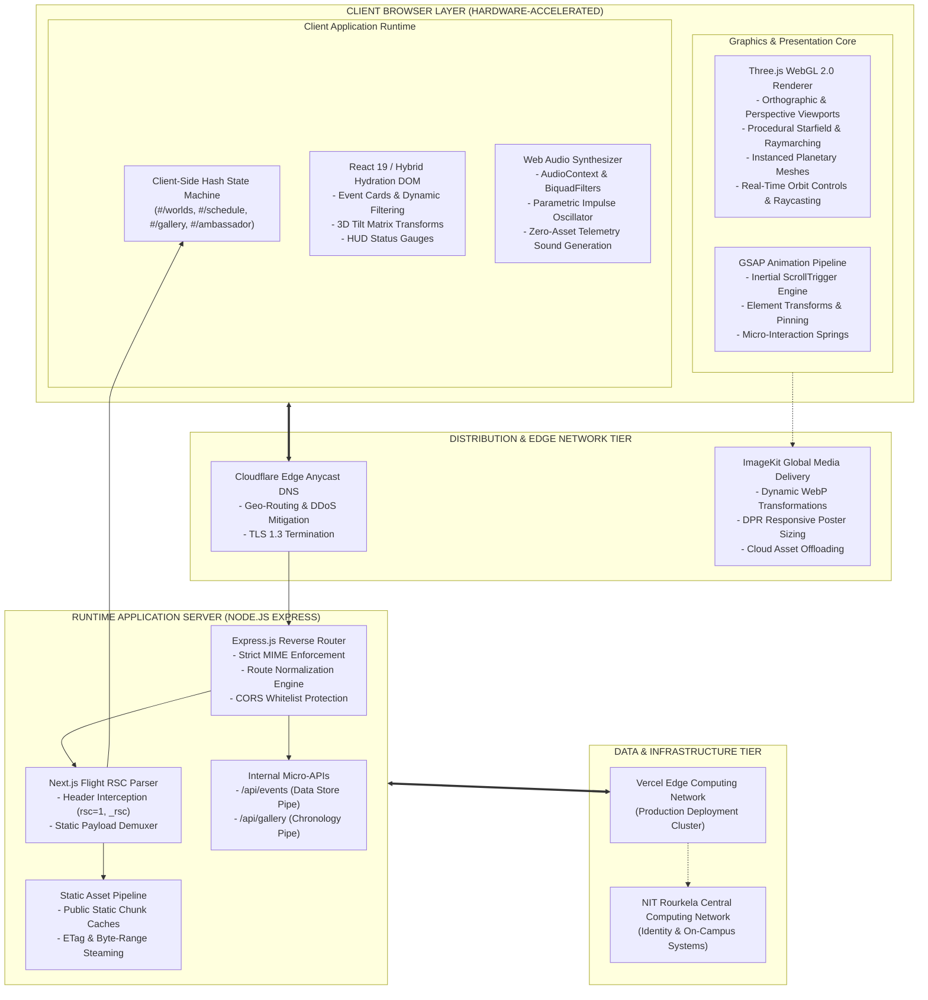

<div align="center">


# INNOVISION 2026
### NATIONAL INSTITUTE OF TECHNOLOGY, ROURKELA
#### Flagship Annual Techno-Management Fest & Autonomous Space-Themed Interface Engine

[](https://www.innonitrkl.com/)
[](https://www.nitrkl.ac.in/)
[](https://nodejs.org/)
[](https://threejs.org/)
[](https://nextjs.org/)

**Production Endpoint:** [https://www.innonitrkl.com/](https://www.innonitrkl.com/)  
**Parent Institution:** National Institute of Technology, Rourkela (Institute of National Importance under Ministry of Education, Govt. of India)

</div>

---

## 01. EXECUTIVE ARCHITECTURAL SUMMARY

The official web platform for **InnoVision 2026 (NIT Rourkela)** implements an asymmetric distributed web-engine engineered for zero-latency event orchestration, high-concurrency client navigation, and hardware-accelerated volumetric 3D scene synthesis. 

Serving as the digital command center for Eastern India's largest annual techno-management convention, the system integrates a deterministic client-side Single Page Application (SPA) state machine, real-time procedural WebGL rasterization, synthesized low-latency audio telemetry via the Web Audio API, and a custom Node.js Express edge gateway delivering React Server Component (RSC) payload streams with static fallbacks.

---

## 02. FULL-SCALE ENTERPRISE SYSTEM ARCHITECTURE



---

## 03. COMPONENT & PROTOCOL SPECIFICATIONS

### A. WebGL 2.0 Real-Time Space Engine
- **Engine Core:** Three.js `r185` compiled via Webpack dynamic chunking with tree-shaken geometric buffers.
- **Volumetric Space Environment:** 
  - Dynamic starfields calculated procedurally via vertex-buffered point clouds (`BufferGeometry`).
  - Physically based custom lighting models utilizing ambient illumination, point spotlights, and emissive material multipliers.
  - Interactive celestial bodies including high-resolution planetary meshes (Earth, Mars, Mercury, crescent and storm variants) mapped to customized rotation and orbital vector velocities.
  - Interactive Raycaster tracking pointer coordinates mapped to normal projection screens with matrix lerping for 60 FPS transitions.

### B. Audio Synthesis & Telemetry System
- **Synthesizer Core:** Native Web Audio API (`AudioContext`, `OfflineAudioContext`).
- **Telemetry Beep Synthesizer:** High-frequency sinusoidal oscillations routed through a `GainNode` with logarithmic volume decay curves, eliminating audio asset payload latency.
- **Audio Feedback Integration:** Synchronized trigger events attached to client navigation, schedule shifts, and button interactions.

### C. Server Architecture & RSC Flight Routing
- **Reverse Routing Gateway:** Express.js 4.21 runtime providing full route handling for dynamic Next.js App Router exports.
- **Flight Request Detection:** Custom middleware interrogates incoming request headers for `RSC: 1` or query parameter `_rsc` to dynamically serve `.rsc` payload serialization blocks or standard `.html` hydration roots.
- **MIME & Byte Streaming:** Static assets, fonts (`.woff2`), scripts, and image formats (`.webp`, `.png`, `.svg`) are served with cache-control immutability and byte-range partition headers.

---

## 04. DIRECTORY & REPOSITORY TOPOLOGY

```
D:\NITR
|-- .gitignore                      # Git configuration & ignore matrix
|-- package.json                    # Node runtime dependency manifest
|-- package-lock.json               # Deterministic dependency lockfile
|-- server.js                       # Express.js reverse router & server engine
|-- start.bat                       # Win32 automation launch sequence
|-- run.ps1                         # PowerShell pipeline execution script
|-- README.md                       # Enterprise technical documentation
|
|-- public/                         # Public production asset root
|   |-- index.html                  # Core application entrypoint & DOM root
|   |-- index.rsc                   # Next.js App Router Root Flight chunk
|   |-- merch.html                  # Merchandise module viewport
|   |-- privacy.html                # Compliance & privacy framework
|   |-- terms.html                  # Institutional terms & conditions
|   |-- robots.txt                  # Search crawler directives
|   |-- sitemap.xml                 # Canonical XML indexing tree
|   |
|   |-- _next/                      # Compiled Next.js production builds
|   |   `-- static/                 # Versioned Webpack JavaScript chunks & CSS
|   |       |-- chunks/             # Code-split dynamic route modules
|   |       |-- css/                # Minified responsive style trees
|   |       `-- media/              # Sub-subsetted WOFF2 font binaries
|   |
|   |-- assets/                     # Core visual assets & institutional insignia
|   |   |-- nitr_official_logo.png  # High-resolution official NIT Rourkela seal
|   |   |-- INNOVISION LOGO.png     # Official InnoVision festival insignia
|   |   |-- starfield.svg           # High-density vector star map
|   |   |-- rocket.svg              # Mission profile SVG
|   |   |-- payment-qr.webp         # Direct merchant payment QR buffer
|   |   `-- *.webp                  # Compressed planetary & astronaut geometries
|   |
|   |-- events/                     # World event categorization payloads
|   |   |-- flagship-events.*       # Tier 1 Competitions (Hackathons, AI, Robotics)
|   |   |-- standout-events.*       # Tier 2 Engineering Showcases
|   |   |-- main-events.*           # Domain coding, circuit & gaming arenas
|   |   `-- dts-and-fun-events.*    # Informal challenges & cultural events
|   |
|   |-- api/                        # Mock data services
|   |   |-- events.json             # Consolidated event schedules & rules
|   |   `-- gallery.json            # Historical archives & media pointers
|   |
|   `-- imagekit/                   # Cached ImageKit CDN static proxies
|       |-- b4kmkfgaod/             # Historical posters & sponsor registries
|       `-- zr1vkuqit/              # Official festival merchandise assets
|
`-- tools/                          # Administrative inspection & scraping tooling
    |-- crawl_pages.py              # Autonomous multi-route validation crawler
    |-- download_all_assets.py      # Automated asset synchronization agent
    |-- extract_all_media.py        # Webpack bundle media analyzer
    `-- inspect_api.py              # Endpoint schema regression test suite
```

---

## 05. ROUTE MAP & APPLICATION STATE MATRIX

| Route Path | Type | Target Payload | Primary Subsystems |
| :--- | :--- | :--- | :--- |
| `#/` | Client Hash SPA | `index.html` + `index.rsc` | Three.js Solar Horizon, Hero HUD, Orbit Selectors |
| `#/worlds/flagship-events` | Client Hash SPA | `events/flagship-events.html` | Flagship Event Grid, Modal Rulebooks, Registration Link |
| `#/worlds/standout-events` | Client Hash SPA | `events/standout-events.html` | Standout Challenge Display, Team Matrix, Rules |
| `#/worlds/main-events` | Client Hash SPA | `events/main-events.html` | Departmental Challenges, Technical Contests |
| `#/worlds/dts-and-fun-events` | Client Hash SPA | `events/dts-and-fun-events.html` | Informals, Stargazing, Quizzes, E-Sports Arena |
| `#/schedule` | Client Overlay | Dynamic JSON (`/api/events`) | 3D Interactive Tilt Cards, Venue Filter, Day 1-3 Matrix |
| `#/gallery` | Client Overlay | Dynamic JSON (`/api/gallery`)| 3D Retrospective Memory Wall, Chronological Timeline |
| `#/ambassador` | Client Dialog | Client State Handler | Referral Code Validator, Live Point Calculator |
| `/merch` | Static Page | `merch.html` + `merch.rsc` | 3D Apparel Customizer, Color Palette Selector |
| `/privacy` | Static Document | `privacy.html` | Institutional Compliance, Data Protection Policy |
| `/terms` | Static Document | `terms.html` | Event Participation Guidelines & Safety Norms |

---

## 06. DEPLOYMENT & LOCAL EXECUTION PIPELINE

### Prerequisites
- Node.js LTS (Version 18.x, 20.x, or 22.x)
- Native Shell (PowerShell 7+, Windows Terminal, or POSIX bash)
- Port availability: `3000` (Default, reconfigurable via environment variables)

### Automated Initialization Sequence

#### Option A: Native Command Line Execution
```bash
# Clone the verified repository
git clone https://github.com/Aniket-Das-2006/InnoVision26--NITR.git

# Navigate into the deployment root
cd InnoVision26--NITR

# Install dependencies (Express 4.x runtime)
npm install

# Start the reverse routing engine
npm start
```

#### Option B: Windows Automation Script
```powershell
# Open terminal inside the repository folder and execute:
.\run.ps1
```
*(Or double-click `start.bat` for automatic port resolution and default browser launch).*

### Production Gateway Verification
Once running, verify network socket status:
```text
[HTTP] Engine active on: http://localhost:3000
[HTTP] Direct SPA hash: http://localhost:3000/#/
[API]  Event registry:  http://localhost:3000/api/events
[API]  Gallery stream:  http://localhost:3000/api/gallery
```

---

## 07. INSTITUTIONAL METRICS & CITATION

```yaml
Institution: National Institute of Technology, Rourkela
Location: Rourkela, Sundargarh, Odisha, India - 769008
Festival Name: InnoVision 2026
Production Domain: https://www.innonitrkl.com/
Repository: https://github.com/Aniket-Das-2006/InnoVision26--NITR
Classification: Public Techno-Management Platform Architecture
Engine Stack: Next.js App Router | Three.js WebGL 2.0 | Express.js Gateway
```

---

<div align="center">

**National Institute of Technology, Rourkela**  
*Established under the National Institutes of Technology Act, Government of India*  
Official Festival Platform &bull; InnoVision 2026

</div>
