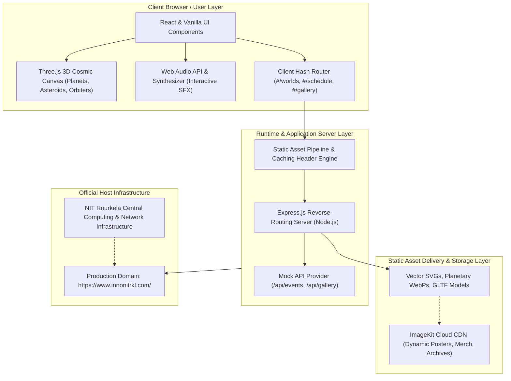

# 🚀 InnoVision 2026 — NIT Rourkela Official Website

<div align="center">


&nbsp;&nbsp;&nbsp;&nbsp;&nbsp;&nbsp;&nbsp;&nbsp;


### **The Annual Techno-Management Fest of National Institute of Technology, Rourkela**
*Eastern India's Largest Techno-Management Extravaganza*

🌐 **Live Website:** [https://www.innonitrkl.com/](https://www.innonitrkl.com/)  
📍 **Hosted By:** National Institute of Technology, Rourkela (NITR)

---

[](https://nodejs.org/)
[](https://expressjs.com/)
[](https://threejs.org/)
[](https://www.innonitrkl.com/)

</div>

---

## 📖 Overview & Web Description

**InnoVision** is the premier annual flagship techno-management fest organized by the student community at the **National Institute of Technology, Rourkela**. Serving as a crucible for technology enthusiasts, coders, roboticists, innovators, and future entrepreneurs across India, InnoVision brings together thousands of participants for high-stakes hackathons, design sprints, paper presentations, exhibitions, pro-shows, and futuristic interactive gaming arenas.

This repository hosts the full implementation of the official **InnoVision 2026** platform accessible at [**https://www.innonitrkl.com/**](https://www.innonitrkl.com/). The experience features an immersive space-themed user interface, real-time 3D celestial animations, custom dynamic sound synthesis, seamless Single Page Application (SPA) navigation, complete event schedules, official merchandise portal, campus ambassador onboarding, and interactive ticketing passes.

---

## 🏛️ System Architecture

The project architecture combines high-performance client-side rendering with an expressive micro-service distribution model:



### Architectural Highlights
1. **Interactive Cosmic Viewport**: Hardware-accelerated 3D environment powered by Three.js rendering procedural starfields, realistic orbital rotation, interactive solar systems, and interactive spacecraft dynamics.
2. **Audio Reactive Interface**: Custom synthesized sound effects leveraging the browser's `Web Audio API` (`AudioContext` and `OfflineAudioContext`) coupled with procedural sound generation for haptic feedback on navigation.
3. **Decoupled Asset Distribution**: Heavy media assets, event banners, and merchandise previews are pre-optimized in WebP format and synchronized with ImageKit CDN caching.
4. **Resilient Routing & Fallbacks**: Fully static SPA routing with hash-based views (`#/worlds/*`, `#/schedule`, `#/gallery`, `#/ambassador`), ensuring zero 404s on direct reloads and edge proxy serving.

---

## 🪐 Key Features & Modules

- **🌌 3D Space Horizon**: Real-time rendering of cosmic bodies (Earth, Mars, Mercury, Ringed Planets, Asteroids) and interactive astronauts.
- **🏆 Event Ecosystem**:
  - `Flagship Events`: National-level Hackathons, Robotics, and AI Arenas.
  - `Standout Events`: Premier engineering contests and innovation showcases.
  - `Main Events`: Domain-specific coding, circuit design, and gaming battles.
  - `DTS & Fun Events`: Informals, quizzes, stargazing, and cultural nights.
- **📅 Interactive Schedule**: 3D interactive card tilts for Day 1, Day 2, and Day 3 venue timetables with category filters.
- **🖼️ 3D Gallery & Archives**: Interactive memory wall showcasing past festival editions and historical highlights.
- **👕 Official Merch Store**: Interactive 3D apparel showcase featuring hoodies, tees, and zippers with real-time color swatches.
- **🎟️ Registration HUD**: Interactive registration passes with live seat counter tracking and dynamic verification.
- **🤝 Campus Ambassador Portal**: Referral management dialog with live code authentication and incentives dashboard.

---

## 💻 Tech Stack

- **Runtime:** Node.js (v18.x / v20.x / v22.x)
- **Backend:** Express.js (`server.js`)
- **3D Graphics & Animation:** Three.js (r185), WebGL 2.0, GSAP, ScrollTrigger
- **Audio Engine:** Web Audio API (`AudioContext`, `BiquadFilterNode`, `GainNode`)
- **Styling:** Modern CSS3, Sora & Space Grotesk Typography, Cyberpunk Glassmorphism
- **Asset Pipeline:** Next.js Static Export, ImageKit WebP optimization

---

## 🚀 Local Development Setup

### Prerequisites
- [Node.js](https://nodejs.org/) (version 18 or higher recommended)
- `npm` or `yarn`

### Installation & Run

1. **Clone the repository:**
   ```bash
   git clone https://github.com/Aniket-Das-2006/InnoVision26--NITR.git
   cd InnoVision26--NITR
   ```

2. **Install dependencies:**
   ```bash
   npm install
   ```

3. **Start the server:**
   ```bash
   npm start
   ```
   *Windows users can also simply run `.\run.ps1` or double-click `start.bat`.*

4. **Access the application:**
   Open your browser at `http://localhost:3000` (or `http://localhost:3000/#/`).

---

## 🌐 Official Links

* **Official Fest Website:** [https://www.innonitrkl.com/](https://www.innonitrkl.com/)
* **Institute Website:** [https://www.nitrkl.ac.in/](https://www.nitrkl.ac.in/)
* **GitHub Repository:** [https://github.com/Aniket-Das-2006/InnoVision26--NITR](https://github.com/Aniket-Das-2006/InnoVision26--NITR)

---

<div align="center">
Crafted with passion for <b>InnoVision 2026</b> &bull; <b>National Institute of Technology, Rourkela</b>
</div>
